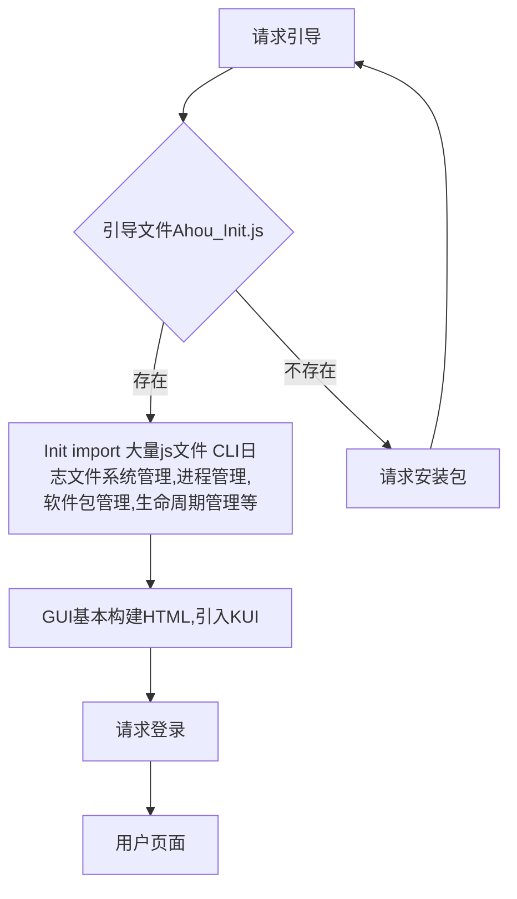

# Ahou System

## 介绍

> **Ahou System**是一款由*Yangko Studio*开发的纯前端操作系统，旨在基于OPFS技术构建一个快捷的工作环境。

> [!WARNING]
> 此软件至少要在2028年第二季度后才能正常使用！

| 信息 | 状态                                                                                |
|:----:|-------------------------------------------------------------------------------------|
| 名称 | Ahou System                                                                         |
| 开发 | [Yangko Studio](https://github.com/ykstu) (Ahou Software[^1],Chuylab[^2],ldybR[^3]) |
| 版本 | XXIX Dev *fix* 0                                                                    |
| 许可 | [GNU General Public License v3.0](LICENSE)                                          |
| 版权 | Copyright © 2018 - 2026 Yangko. All Rights Reserved.                                |


**粗体**、*斜体*、~~删除线~~、`行内代码`


```javascript
Boot('/System/Boot/Init.js')
```

## 开发进程

- [ ] XXIX内核基本
- [ ] 系统页面KUI
- [ ] App


[^1]: Yangko Studio设立的软件开发部门。

[^2]: Yangko Studio设立的软件测试、资源整合搜集部门。

[^3]: Yangko Studio设立的游戏开发部门、餐厅。



